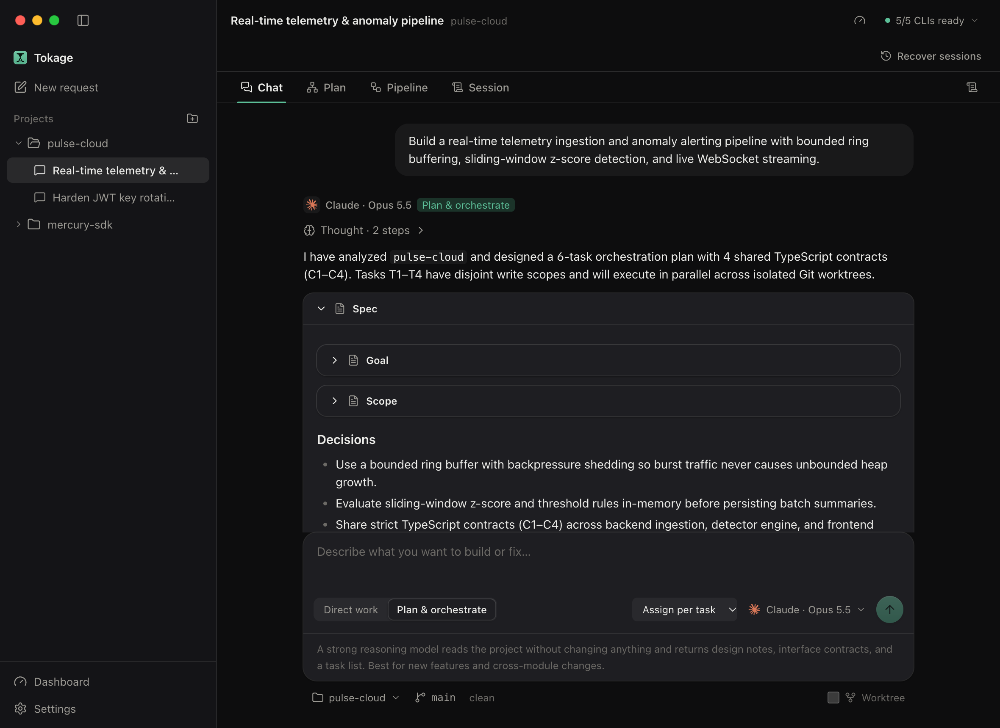
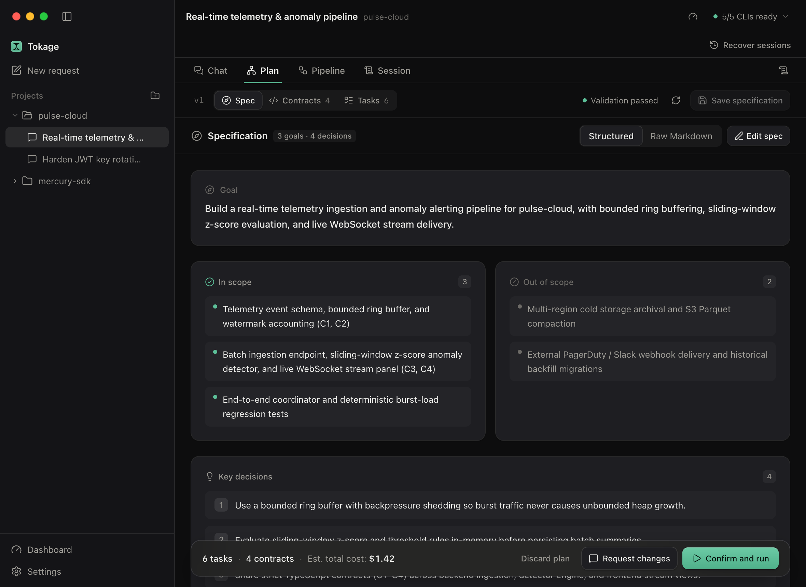
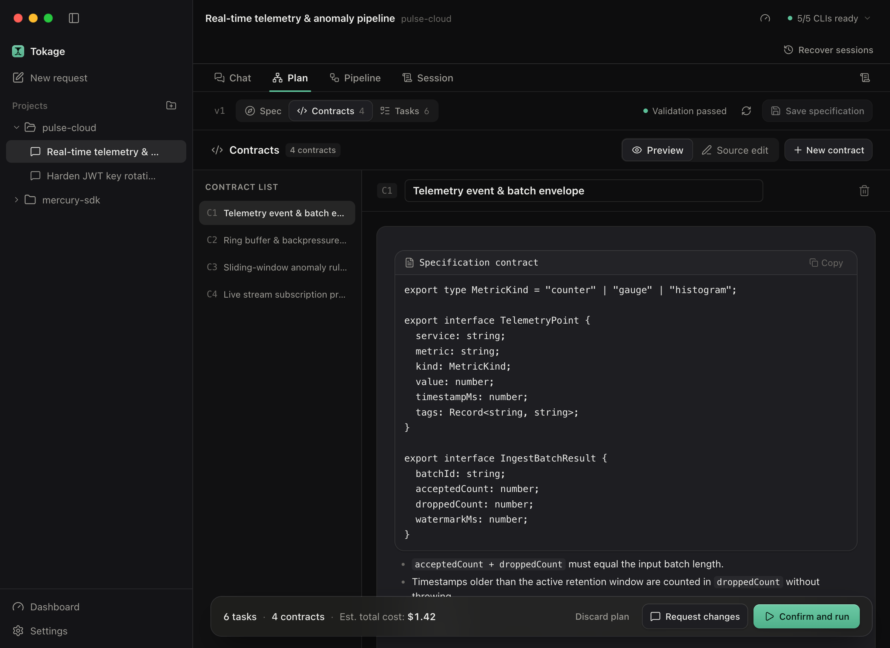
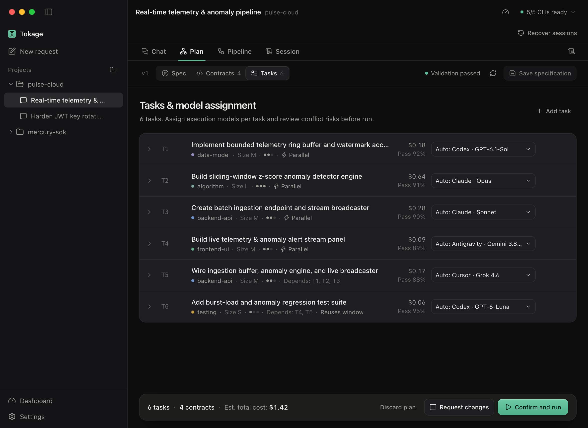
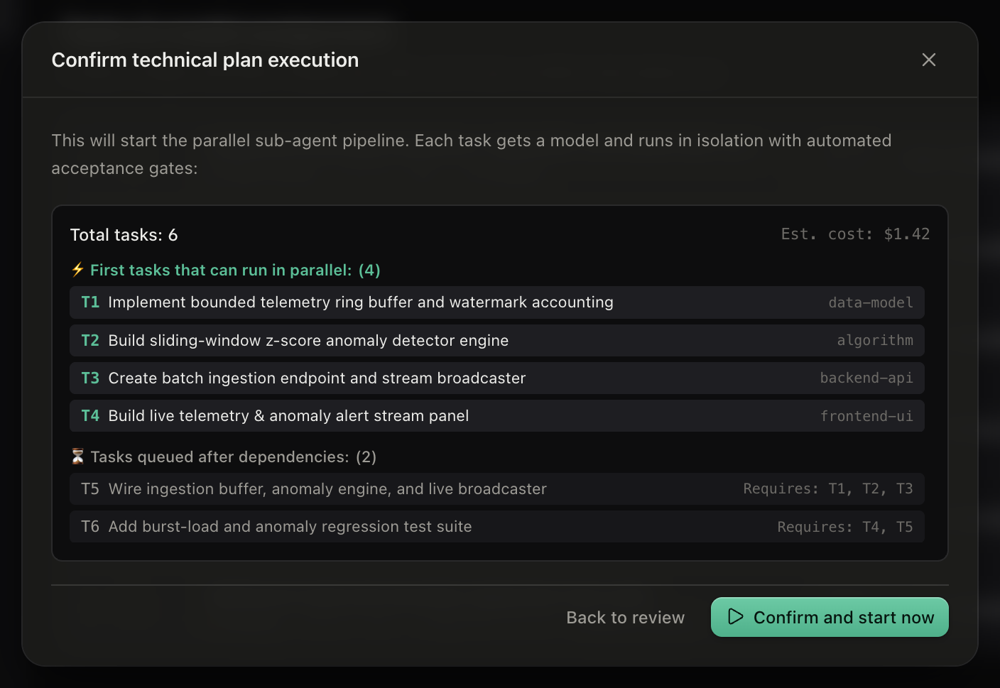

# Tokage

**English** | [中文](README.zh-CN.md)

**Tokage** is a vendor-neutral local desktop gateway and headless CLI that orchestrates the official AI coding CLIs installed on your machine—including **Claude Code**, **Codex CLI**, **Cursor CLI**, **GitHub Copilot CLI**, **Antigravity CLI**, **OpenCode**, **Kiro CLI**, **Aider**, and **Reasonix**—so you can work directly with a single agent or run a multi-model pipeline that **does more work with fewer tokens**.

Built with **Tauri 2**, **Rust**, and **React**. Tokage never replaces your CLIs or proxies your prompts through an intermediate cloud; it coordinates your existing tools locally.

<p align="center">
  
</p>

---

## Mission

Integrate what you already have so the **smallest spend produces the largest useful effect**.

Spend includes more than money:

- **Money** — API bills and subscription quota burn
- **Tokens** — every prompt, retry, and completion that did not need to be sent
- **Energy** — the inference compute behind those tokens
- **Environment** — less wasted compute across everyone who builds software with AI

Instead of throwing a single frontier model at every edit, test run, and retry, Tokage puts strong reasoning where architectural decisions happen and routes scoped implementation and verification to the most cost-effective capable models.

---

## Two Work Styles: Direct Work & Planned Orchestration

Tokage adapts to the complexity of your task with two first-class modes in the composer:

### 1. Direct Work (`Direct work`)

New sessions default to **Direct work** for everyday coding, debugging, and repository Q&A with zero planning ceremony:

- **Local Model Recommendation or Manual Choice** — Pick any ready CLI and model (including reasoning effort and context window variants), or let Tokage recommend the best fit for your prompt.
- **Strict Session Continuity** — Follow-up turns stay on your chosen CLI session without silent failover. If a session is interrupted by an app restart, Tokage surfaces recoverable native transcripts directly in the workspace.
- **Smart Model Handoff** — When you switch models mid-conversation, Tokage lets you switch immediately or generate an editable **Smart Handoff** brief (summarizing goals, completed changes, key decisions, and open items) to seed a clean context window on the new model.
- **Upgrade to Plan** — When a direct conversation grows into a larger multi-file change, you can promote it into a linked **Plan & orchestrate** session while preserving the original conversation history.

### 2. Plan & Orchestrate (`Plan & orchestrate`)

For new features, cross-module refactors, and multi-file work, **Plan & orchestrate** separates architectural design from parallel implementation:

- **Assign per task** — A strong planner produces the specification, shared contracts, and task DAG; Tokage's Bayesian matching engine assigns each task to the model with the lowest expected total cost that clears the first-pass confidence threshold.
- **Single model** — Keep the full structured workflow (Specification, Shared Contracts, isolated Git worktrees, and zero-token local acceptance gates) while pinning a single model across all tasks.
- **Markdown Plan Import** — Import an existing `# Spec` / `# Contracts` / `# Tasks` Markdown document directly into the visual review and execution pipeline.

---

## How Orchestration Works

Tokage does not "try a cheap model first and escalate on failure"—a failed cheap run is already wasted tokens and context. Instead, it **plans once with a strong reasoning model, enforces strict interface contracts, executes independent tasks in parallel Git worktrees, and verifies locally at zero token cost**.

```text
You describe a goal
        │
        ▼
┌───────────────────────────────┐
│  1. CLI & Health Management   │  Discover official CLIs, sync model catalogs,
│                               │  track quotas, and trip circuit breakers on faults
└───────────────┬───────────────┘
                ▼
┌───────────────────────────────┐
│  2. Model Knowledge & Scoring │  Domain skills (1–5), pricing, cache traits,
│                               │  prior pass probabilities + local Bayesian learning
└───────────────┬───────────────┘
                ▼
┌───────────────────────────────┐
│  3. Strong-Model Planning     │  Read-only repo digest → Spec, Shared Contracts,
│                               │  and conflict-checked Task DAG
└───────────────┬───────────────┘
                ▼
┌───────────────────────────────┐
│  4. Parallel Worktree Runs    │  Each task runs in an isolated Git worktree
│                               │  under OS sandboxing and write-scope guardrails
└───────────────┬───────────────┘
                ▼
┌───────────────────────────────┐
│  5. Zero-Token Local Gates    │  Local build / typecheck / test acceptance gates
│     & Repair Ladder           │  before merging back to your target branch
└───────────────────────────────┘
```

### Interactive Plan Review

Before any code is written, Tokage opens an interactive **Plan Review** workspace where you can inspect, edit, or request targeted replanning:

1. **Specification (`Spec`)** — Structured **Goal**, **In Scope / Out of Scope** boundaries, and **Key Architectural Decisions**, with side-by-side structured and raw Markdown editing.
2. **Shared Contracts (`Contracts`)** — Explicit TypeScript/interface definitions and invariants (`C1`, `C2`, …) injected into every dependent task prompt so parallel agents never drift on types or signatures.
3. **Tasks & Model Assignment (`Tasks`)** — Visual task list showing domain tags, size/difficulty ratings, write scopes, dependency edges, first-pass probability (`Pass %`), estimated cost, and per-task model selectors.
4. **Confirm & Run** — Pre-flight summary grouping tasks into immediate parallel waves versus dependency-queued waves, with total estimated cost.

| Specification (`Spec`) | Shared Contracts (`Contracts`) |
|:----------------------:|:------------------------------:|
|  |  |

| Tasks & Model Assignment (`Tasks`) | Confirm Parallel Execution |
|:----------------------------------:|:--------------------------:|
|  |  |

During or after execution, you can also trigger **Incremental Replanning** (computing a structural diff across specs, contracts, and affected tasks) or **Supplement Tasks** into an active pipeline.

---

## Core Design Pillars

### Model Knowledge Base & Bayesian Matching

Tokage ships with a signed **Model Definition Pack** (updatable online or customizable with local overrides) that serves as the prior knowledge base for routing:

| Dimension | Purpose |
|-----------|---------|
| **Domain skill ratings (`1–5`)** | Per-domain proficiency across `frontend-ui`, `backend-api`, `data-model`, `algorithm`, `refactoring`, `testing`, `devops`, `documentation`, `security`, and `planning` |
| **Pricing & billing traits** | Token rates (`input`, `output`, `cache_read`, `cache_write`) and billing mode (metered API vs. subscription quota weight) |
| **Context & cache mechanics** | Effective context window limits, cache type (`ephemeral` TTL vs. `prefix`), and native compaction support |
| **Role capabilities** | Eligibility and strength for `planner`, `executor`, and `reviewer` roles |

**Selection Objective:** Among all healthy, authorized models whose predicted first-pass success probability clears the confidence threshold ($P(\text{pass}) \ge \tau$), Tokage selects the model that minimizes **expected total cost** (initial execution cost plus weighted repair cost):

1. **Prior** — Logistic probability derived from the model's domain skill score relative to the task's difficulty (`1–5`) and size (`S / M / L`).
2. **Posterior** — Local Beta-Binomial updates recorded in SQLite from your actual task outcomes (`FIRST_PASS`, `FIXED_IN_WINDOW`, `REASSIGNED`, `USER_TAKEOVER`, `FAILED`).

### Isolated Execution, Verification Gates & Repair Ladder

- **Git Worktree Isolation** — Every orchestrated task executes in its own dedicated Git worktree (`git worktree`). Tasks with overlapping `write_scope` globs are automatically serialized during plan validation so parallel agents never clobber each other's files.
- **Zero-Token Local Verification** — Completion of a CLI turn does not mark a task `DONE`. Tokage runs the task's acceptance commands (`build`, `typecheck`, `test`, `lint`) locally on your machine using zero model tokens, and verifies that modified files stay within the declared `write_scope`.
- **Automated Repair Ladder & Takeover** — If an acceptance gate fails, Tokage feeds the structured compiler/test diagnostics back into the warm context window for an in-place fix, escalates up the model ladder when needed, or lets you **Take Over** the worktree directly before merging or exporting patches.

### Cache-Aware Context Lifecycle

Long sessions degrade both model accuracy and token economics. Tokage's **Context Lifecycle Engine** monitors real-time window occupancy and prompt-cache warmth (`ContextBar`):

- **Cache-TTL Awareness** — Avoids premature compaction while an `ephemeral` cache window is still warm and cheaper to reuse.
- **Configurable Modes (`off` / `suggest` / `auto`)** — Supports native CLI compaction commands (`COMPACT`) or structured state extraction into a fresh window (`FRESH`) with cooldown protection.
- **Cross-Task Window Reuse (`REUSE`)** — When a downstream task in the DAG shares the same model and domain context as a completed upstream task with a warm cache, Tokage can reuse the verified session window to save cold-start input tokens.

### CLI Health, Quota Awareness & Circuit Breaking

- **Live Health State Machine** — Tracks each provider across `READY`, `MELTED` (circuit-broken), and `HALF_OPEN` states. Rate limits (`429`), quota exhaustion, or authentication errors automatically trip a cooldown timer and re-route pending tasks to healthy providers.
- **Headless CLI & Shared Runtime** — The `tokage` command-line binary shares the exact same Rust orchestration and direct-execution runtime as the desktop app, enabling terminal workflows, scripts, and CI automation.
- **Built-in Offline Demo Mode** — Explore the entire planning, contract review, parallel DAG execution, repair ladder, and branch delivery workflow offline at zero token cost via **Settings → Planning & models → Demo mode**.

---

## Security & Privacy Commitments

Tokage is a **local orchestrator**, not a cloud proxy or man-in-the-middle for vendor APIs.

- **Native Credential Isolation** — Each official CLI manages its own authentication. Local login status and local usage history are read by default. When you explicitly opt into *"Allow online usage queries"*, Tokage invokes verified non-inference CLI commands or fixed vendor read-only quota endpoints in native Rust memory; credentials never enter prompts, frontend state, logs, or external servers.
- **OS Sandboxing & Command Guardrails** — Task subprocesses are wrapped in OS-level sandboxes (`sandbox-exec` seatbelt profiles on macOS; Landlock / `bwrap` on Linux) restricting file writes to the assigned worktree, paired with a three-tier command authorization policy (`Allow`, `Ask`, `Deny`) and secret redaction.
- **Verifiable Builds** — Always run official signed releases or compile directly from this repository.

---

## Documentation

- **Headless CLI Guide**: [CLI Commands & Workflows](docs/cli.md)
- **Single-Agent & Direct Mode**: [Direct Work Architecture & Boundaries](docs/single-agent.md)
- **Usage & Quota Support Matrix**: [CLI Usage Support Audit](docs/cli-usage-support-audit.md)

### Architecture & Engine Design Docs

*(English by default; switch to Chinese at the top of each document)*

| Module | Topic |
|--------|-------|
| [00 — Architecture Overview](docs/00-architecture-overview/README.md) | End-to-end system topology, data flow, and design principles |
| [01 — Native Environment Engine](docs/01-native-environment-engine/README.md) | CLI discovery, capability probing, process trees, and OS sandboxing |
| [02 — Planning Engine](docs/02-planning-engine/README.md) | Repo digest generation, structured Spec/Contracts/Tasks parsing, and DAG validation |
| [03 — Orchestration Engine](docs/03-orchestration-engine/README.md) | Worktree scheduling, zero-token acceptance gates, repair ladder, and incremental replanning |
| [04 — Model Matching Engine](docs/04-model-matching-engine/README.md) | Model definition pack schema, Bayesian prior/posterior scoring, and expected cost routing |
| [05 — Context Lifecycle Engine](docs/05-context-lifecycle-engine/README.md) | Cache-aware occupancy tracking, `COMPACT` / `FRESH` / `REUSE` decision policies |
| [06 — Usage & Melting Engine](docs/06-usage-melting-engine/README.md) | Token accounting, quota tracking, and provider circuit-breaker state machine |
| [07 — Session Aggregation Engine](docs/07-session-aggregation-engine/README.md) | Cross-CLI stream normalization, event logs, and session recovery |
| [08 — Storage](docs/08-storage/README.md) · [09 — Guardrails](docs/09-guardrails/README.md) | SQLite persistence schema, secret redaction, and write-scope enforcement |
| [10 — Frontend](docs/10-frontend/README.md) · [11 — Command Authorization](docs/11-command-authorization/README.md) | Workspace UI architecture and command risk classification |
| [12 — Network Proxy](docs/12-network-proxy/README.md) · [13 — Debug Provider](docs/13-debug-provider/README.md) · [14 — Demo Mode](docs/14-demo-mode/README.md) | Proxy propagation, diagnostic harnesses, and offline interactive demo |

---

## Installation

Download prebuilt installers from [GitHub Releases](../../releases):

- **macOS (Apple Silicon / ARM64)**: `Tokage_<version>_aarch64.dmg`
- **Windows (x86_64)**: `Tokage_<version>_x64-setup.exe` or `.msi`

### macOS Gatekeeper Notice on First Launch

If a preview build does not carry an Apple notarization ticket, macOS Gatekeeper may block the app when downloaded through a browser. After dragging `Tokage.app` into `/Applications`, clear the quarantine attribute in Terminal before launching:

```bash
xattr -cr /Applications/Tokage.app
```

*(Alternatively, open **System Settings → Privacy & Security** and click **Open Anyway**.)*

---

## Build from Source

```bash
npm ci
npm run typecheck
npm test
cd src-tauri && cargo test --workspace --locked
```

To launch the desktop app in development mode:

```bash
npm run tauri dev
```

*(Install one or more official AI coding CLIs on your machine to run live sessions, or enable **Demo mode** in Settings to explore Tokage offline.)*

## License

Tokage is licensed under the [MIT License](LICENSE).
