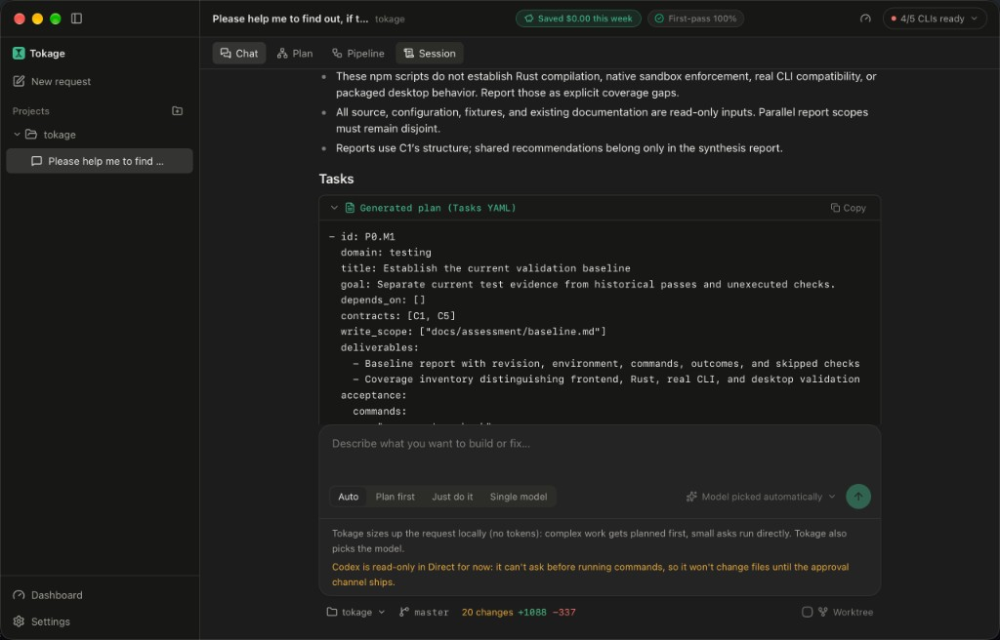
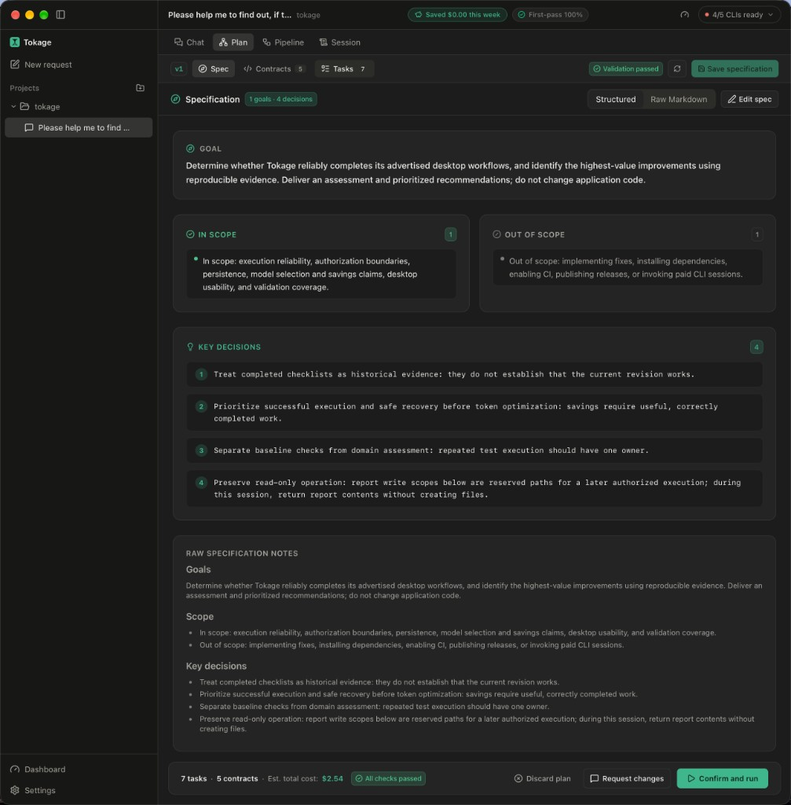
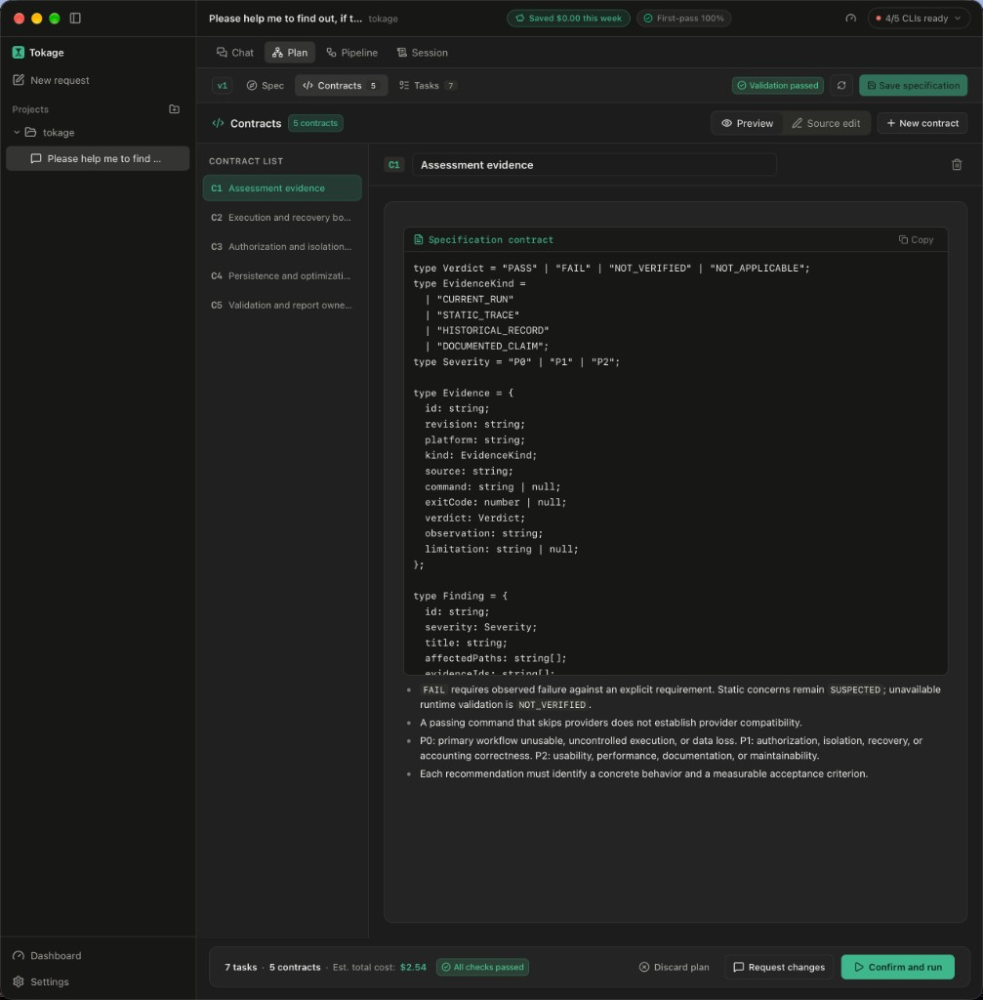
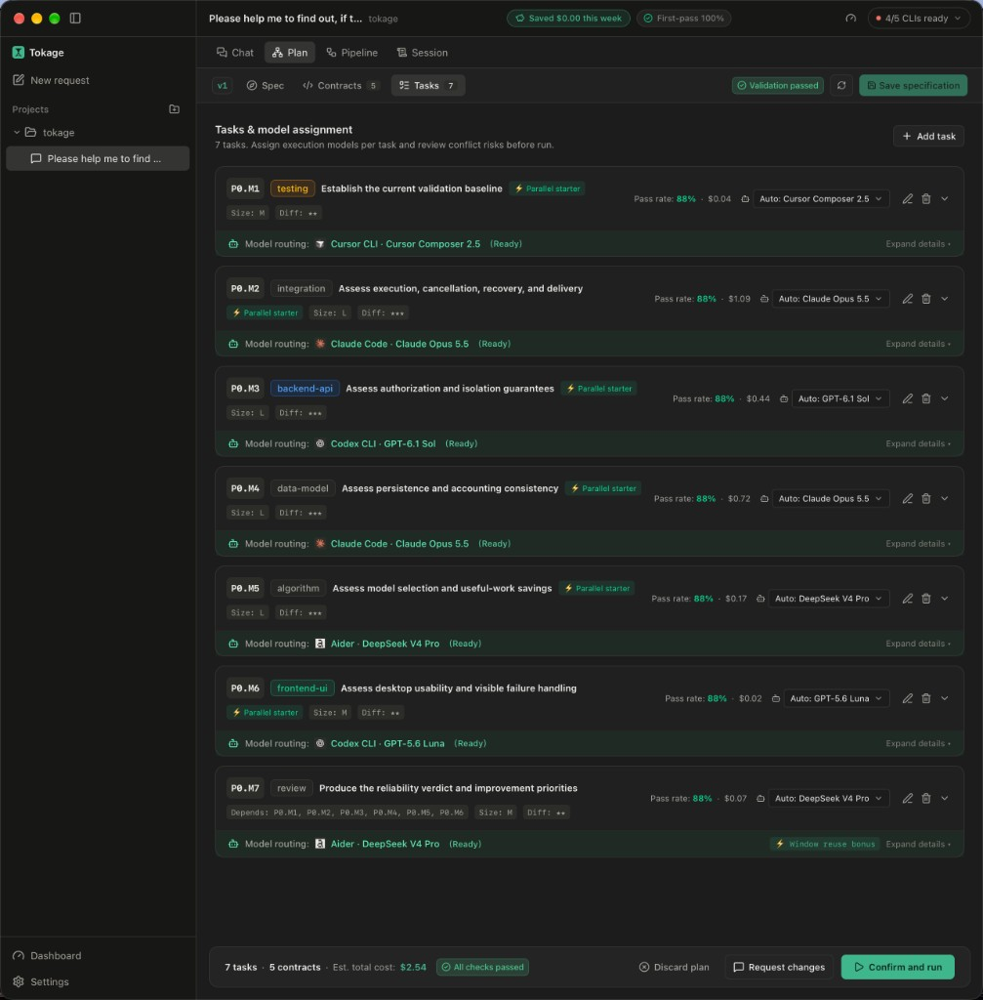
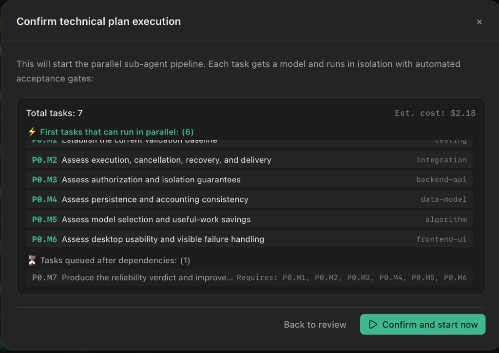

# Tokage（托卡奇）

无头 CLI：[命令、使用流程与验证边界](docs/cli.md)。

可靠性支持范围见 [M2 本轮目标](docs/reliability-m2a.md)，当前自然语言桌面结果与待验组合见 [m2b 验收记录](docs/reliability-m2b.md)。[m2g 验收矩阵](docs/reliability-m2g.md)分开记录真实桌面强杀恢复、分层故障与未测边界。日常可靠性仍待 m3，CLI 就绪不代表可靠性认证。

[English](README.md) | **中文**

本地桌面网关：调度你本机已安装的官方 AI 编程 CLI（Claude Code、Codex CLI、Cursor CLI、OpenCode 等），把一次需求变成多模型协作流水线，用**更少的 Token 完成更多工作**。

技术栈为 Tauri 2、Rust 与 React。厂商中立：Tokage 不替代各家 CLI，只负责编排。

<p align="center">
  
</p>

## 使命

整合你已有的资源，用**最小的花销实现最大的作用**。

「花销」不只是金钱：

- **金钱** — API 账单与订阅额度
- **Token** — 每一轮本可不必发出的提示与生成
- **能源** — 这些 Token 背后的算力
- **环保** — 少浪费算力，人人受益

如果每位开发者都能省下一些 Token，整体节约会在生态中放大。这就是 Tokage 的工作：让人用更少资源做更多事，且不绑定单一厂商。

## 工作方式

Tokage 不靠「先用便宜模型，失败再升级」——便宜模型做砸本身就是浪费。它会先用**强模型规划一次**，再把每个子任务分给**够用且更省**的模型去执行。

```
你提出目标
        │
        ▼
┌───────────────────────┐
│  模型管理             │  发现本机官方 CLI、同步可用模型、跟踪用量
└───────────┬───────────┘
            ▼
┌───────────────────────┐
│  模型知识库           │  领域专长、价格、缓存特性、
│                       │  成功先验 + 本地学习评分
└───────────┬───────────┘
            ▼
┌───────────────────────┐
│  强模型规划           │  精简设计稿、契约、任务图
│                       │  （只做思考与约束——输出短）
└───────────┬───────────┘
            ▼
┌───────────────────────┐
│  小模型干活           │  每任务选「首次通过 × 成本」最优
│                       │  无依赖则并行；共用同一份契约
└───────────┬───────────┘
            ▼
┌───────────────────────┐
│  本地验收             │  本机构建 / 类型检查 / 测试
│                       │  （零 Token）
└───────────────────────┘
```

执行前可以审阅、修改计划。强模型把 Token 花在最值钱的地方；大量编码 Token 由更便宜、但仍足以胜任该任务的模型承担。

### 计划审阅

开工前，Tokage 会给出可编辑的结构化计划：目标与范围、共享契约、带模型路由的任务图，以及含成本与并行说明的确认步骤。

| 规格 | 契约 |
|:----:|:----:|
|  |  |

| 任务与模型分配 | 确认执行 |
|:-------------:|:--------:|
|  |  |

## 模型知识库与评分

Tokage 内置**模型定义包**（可在线更新，也可自定义覆盖）。它是匹配引擎背后的共享数据库：

| 内容 | 作用 |
|------|------|
| 领域专长分（1–5） | 前端、后端、规划、测试…… |
| 价格与计费类型 | 按量 / 订阅的等效成本 |
| 上下文与缓存特性 | 按各 CLI 特点管理上下文 |
| 角色能力 | 规划 / 执行 / 审阅 |

**匹配原则：** 在「首次做对概率够高」的模型里，选**预期总成本最低**的那个（含返工风险）。

评分由两部分合成：

1. **先验** — 定义包里的专长分对照任务难度与规模  
2. **后验** — 你本机的执行结果（首次通过、同窗修复、改派等）持续修正先验  

因此系统从维护者整理的知识起步，并在*你的*项目上越用越准。规划角色优先强规划模型；执行阶段优先通过置信度门槛、且更省的模型。

## 安全承诺

Tokage 是**本地编排器**，不是厂商 API 的代理。

- **绝不**代替你对外发起 CLI / 模型厂商相关请求——不做鉴权、不查额度、不用你的凭据拉 usage。这些仍由你已安装的官方 CLI 自行完成。
- **绝不**读取、保存、记录或上传 API Key / Token。最多读取非密钥配置字段（例如用于展示的 Base URL、用于界面识别的套餐类型）——若解析到 Key 值会立即丢弃。
- Tokage 自身**唯一**的主动外发网络用途：**检查更新**与**下载模型定义包**（基础设施，与你的对话或 CLI 会话无关）。

请使用官方发布包，或自行从本仓库编译。建议核验发布签名与校验值；被篡改的安装包可以声称任何承诺。

## 文档

设计文档（默认英文，各页可切换中文）：

- [总体架构](docs/00-architecture-overview/README.zh-CN.md)
- [规划](docs/02-planning-engine/README.zh-CN.md) · [匹配与定义包](docs/04-model-matching-engine/README.zh-CN.md) · [编排](docs/03-orchestration-engine/README.zh-CN.md)
- [上下文](docs/05-context-lifecycle-engine/README.zh-CN.md) · [用量](docs/06-usage-melting-engine/README.zh-CN.md) · [指令授权](docs/11-command-authorization/README.zh-CN.md)

完整目录见 `docs/`。

## 从源码构建

```bash
npm ci
npm run typecheck
npm test
cd src-tauri && cargo test --workspace --locked
```

需要编排的官方 AI CLI 请另行安装在本机。
