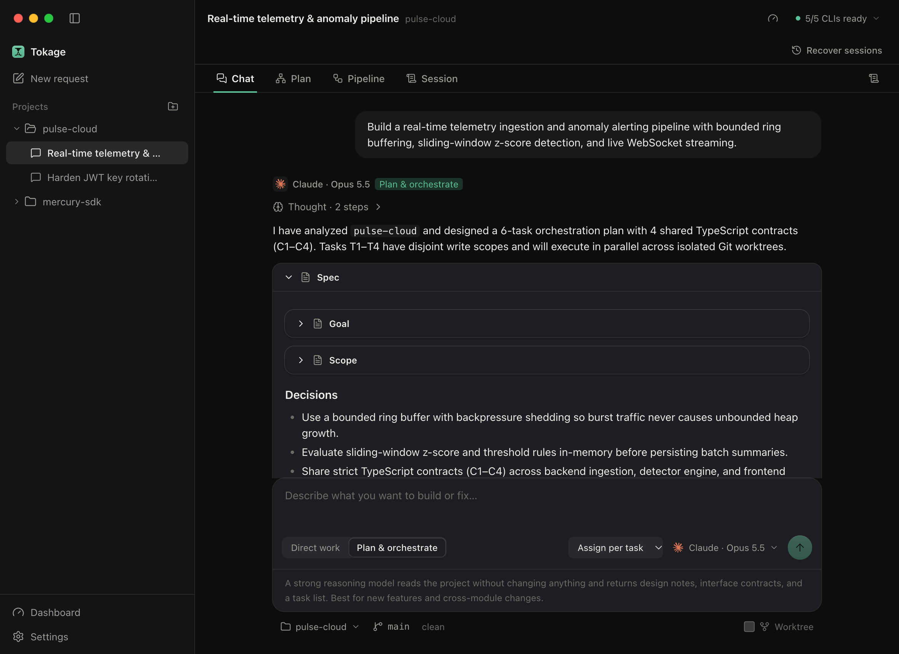
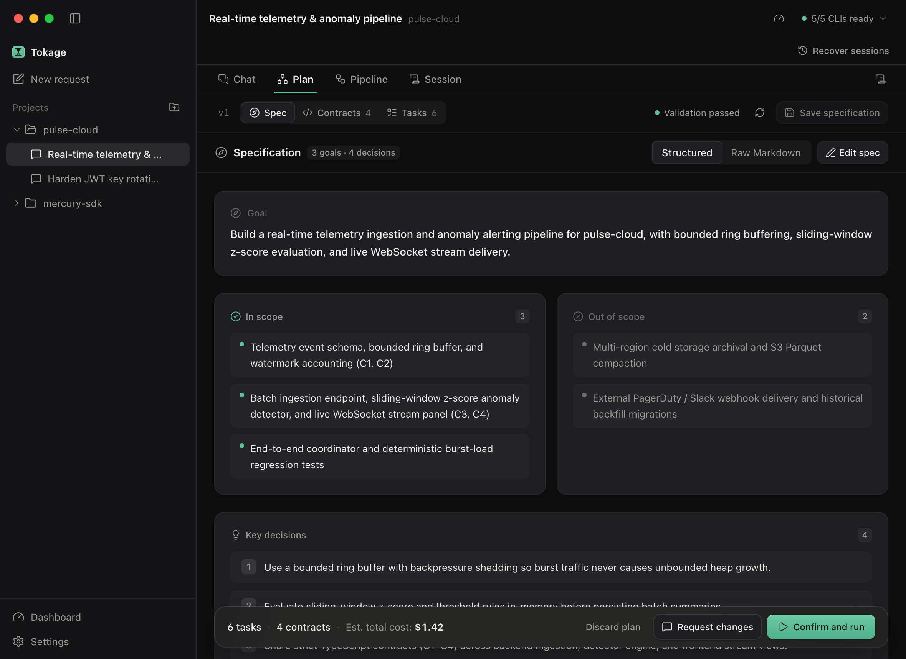
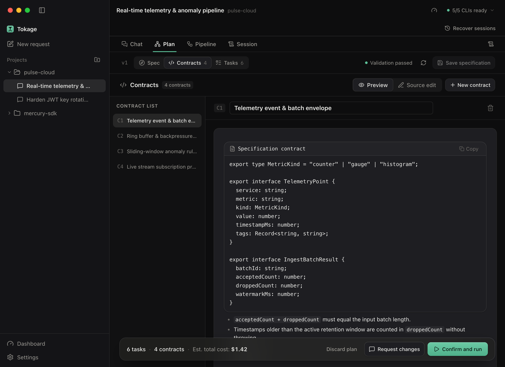
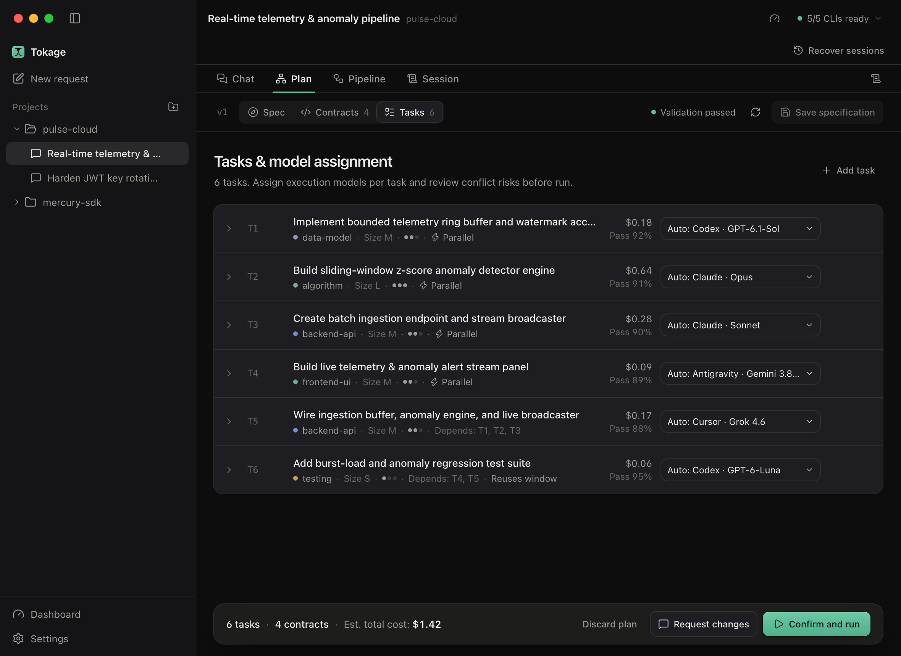
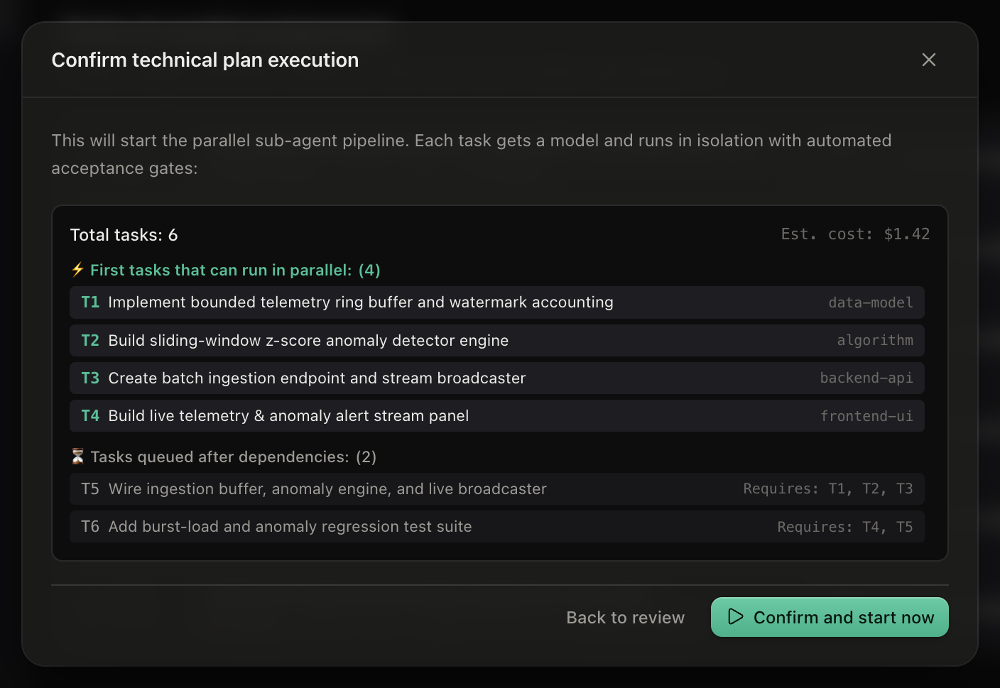

# Tokage（托卡奇）

[English](README.md) | **中文**

**Tokage** 是一个厂商中立的本地桌面网关与无头 CLI（Headless CLI），用于统一调度你本机已安装的官方 AI 编程 CLI——包括 **Claude Code**、**Codex CLI**、**Cursor CLI**、**GitHub Copilot CLI**、**Antigravity CLI**、**OpenCode**、**Kiro CLI**、**Aider** 与 **Reasonix**——让你既能直接与单个 Agent 顺畅对话，也能按需启动多模型协作流水线，用**更少的 Token 完成更多的工作**。

基于 **Tauri 2**、**Rust** 与 **React** 构建。Tokage 不会替代各家官方 CLI，也不会把你的代码或提示词中转到任何第三方云端，而是在本地协同调度你已有的工具。

<p align="center">
  
</p>

---

## 使命

整合你已有的工具与额度，用**最小的花销实现最大的有效产出**。

「花销」不仅是金钱：

- **金钱** — API 账单与订阅额度消耗
- **Token** — 每一轮本可避免的冗长提示、盲目重试与无效生成
- **能源** — 这些 Token 背后的推理算力
- **环保** — 为每一位使用 AI 编程工具的开发者减少无谓的算力浪费

与其把所有简单修改、单测编写和报错重试都扔给最昂贵的旗舰模型，Tokage 让强推理模型专注于架构设计与契约边界，再将边界清晰的子任务路由给最具性价比、首次通过率达标的执行模型。

---

## 两种核心工作方式：直接工作与计划编排

Tokage 在输入框中提供两种一等公民工作模式，随任务复杂度自由切换：

### 1. 直接工作（`Direct work`）

新会话默认进入**直接工作**模式，面向日常编码、调试排查与仓库问答，零规划开销：

- **本地智能推荐或手动指定** — 可自由选择本机已就绪的任意 CLI 与模型（含推理强度、上下文窗口档位），也可交由 Tokage 根据任务特征做本地推荐。
- **严格的会话连续性** — 多轮追问固定沿用当前 CLI 会话，不会在后台静默降级或偷换模型；应用重启后可直接恢复原生执行记录与历史会话。
- **智能模型交接（Smart Model Handoff）** — 当你在长对话中途切换模型时，既可直接切换，也可一键生成可编辑的**结构化交接简报**（自动提炼当前目标、已完成改动、关键决策与待办事项），在全新原生上下文窗口中无缝接续。
- **一键升级为计划（Upgrade to Plan）** — 当一次直接对话逐渐演变为跨文件复杂改造时，可随时将其升级为关联的**计划编排**会话，同时完整保留原对话上下文。

### 2. 计划编排（`Plan & orchestrate`）

面向新功能开发、跨模块重构与多文件协同，将「架构设计」与「并行编码验收」解耦：

- **按任务分配模型（Assign per task）** — 由强模型一次性产出技术规格、共享契约与任务依赖图（DAG），再由贝叶斯匹配引擎为每个子任务分配满足首次通过率门槛且预期总成本最低的模型。
- **单模型执行（Single model）** — 全程固定使用你指定的单一模型，同时完整保留规格审阅、契约约束、Git 独立工作树隔离与本地零 Token 验收门禁。
- **导入 Markdown 计划** — 支持将现有的 `# Spec` / `# Contracts` / `# Tasks` Markdown 计划文档直接导入可视化审阅与流水线执行。

---

## 编排如何工作

Tokage 绝不采用「先拿便宜模型碰运气，失败再升级」的粗放策略——因为便宜模型做砸的一次尝试本身就是 Token 与上下文的浪费。Tokage 的核心设计是：**用强推理模型规划一次，用共享契约锁定接口边界，在隔离的 Git Worktree 中并行执行，并用本地构建与测试完成零 Token 验收**。

```text
你提出需求目标
        │
        ▼
┌───────────────────────────────┐
│  1. CLI 与健康度管理           │  自动发现本机官方 CLI、同步模型目录、
│                               │  跟踪用量额度，异常时自动触发熔断与冷却
└───────────────┬───────────────┘
                ▼
┌───────────────────────────────┐
│  2. 模型知识库与贝叶斯评分     │  领域专长分（1–5）、价格与计费模式、缓存特性、
│                               │  先验通过率 + 本机真实任务后验学习
└───────────────┬───────────────┘
                ▼
┌───────────────────────────────┐
│  3. 强模型架构规划             │  读取轻量仓库摘要 → 生成技术规格（Spec）、
│                               │  共享契约（Contracts）与无冲突任务图（DAG）
└───────────────┬───────────────┘
                ▼
┌───────────────────────────────┐
│  4. 隔离工作树并行执行         │  无依赖任务在独立 Git Worktree 中并行运行，
│                               │  受系统沙箱与写入范围（write_scope）双重保护
└───────────────┬───────────────┘
                ▼
┌───────────────────────────────┐
│  5. 本地零 Token 验收与修复梯  │  本机构建 / 类型检查 / 单元测试自动门禁，
│                               │  支持同窗修复、模型升级、人工接管与分支合并交付
└───────────────────────────────┘
```

### 交互式计划审阅（Plan Review）

在真正改动任何业务代码之前，Tokage 提供结构化的**计划审阅**工作台，供你审阅、手改或要求增量重规划：

1. **技术规格（`Spec`）** — 清晰展示任务目标（Goal）、范围内/外边界（In / Out of Scope）与关键技术决策（Key Decisions），支持结构化卡片与 Markdown 源码双视图编辑。
2. **共享契约（`Contracts`）** — 跨任务共享的数据结构、接口签名与不变式约束（`C1`、`C2`……），自动注入相关子任务提示词，确保并行执行的多个模型不会出现接口偏差。
3. **任务与模型分配（`Tasks`）** — 展示每个子任务的领域标签、规模与难度、写入文件范围（`write_scope`）、前置依赖、首次通过率预估（`Pass %`）、预计花费以及模型分配器。
4. **确认执行（`Confirm & Run`）** — 汇总首波可立即并行启动的任务与后续按依赖排队的任务批次，并展示总预期成本。

| 技术规格（`Spec`） | 共享契约（`Contracts`） |
|:-----------------:|:----------------------:|
|  |  |

| 任务与模型分配（`Tasks`） | 确认并行流水线执行 |
|:------------------------:|:------------------:|
|  |  |

在流水线运行中或运行后，你还可以随时发起**增量重规划（Incremental Replanning）**（自动计算 Spec、Contracts 与受影响任务的精确 Diff）或在当前流水线中**追加补充任务（Supplement Task）**。

---

## 核心架构设计

### 模型知识库与贝叶斯匹配引擎

Tokage 内置带签名校验的**模型定义包（Model Definition Pack）**（支持在线更新或本地自定义覆盖），作为路由决策的共享知识底座：

| 维度 | 作用 |
|------|------|
| **领域专长评分（`1–5`）** | 覆盖 `frontend-ui`、`backend-api`、`data-model`、`algorithm`、`refactoring`、`testing`、`devops`、`documentation`、`security`、`planning` 十大工程领域 |
| **价格与计费特性** | 输入/输出/缓存读写单价，以及按量计费（Metered API）与订阅制（Subscription）等效成本权重 |
| **上下文与缓存机制** | 有效上下文窗口上限、缓存类型（`ephemeral` 临时 TTL 缓存 vs `prefix` 前缀缓存）及原生压缩指令支持 |
| **角色能力标记** | 区分模型在 `planner`（规划）、`executor`（执行）、`reviewer`（审阅）角色上的适配度 |

**最优匹配准则：** 在所有健康、已授权且首次通过概率达到置信度门槛（$P(\text{pass}) \ge \tau$）的候选模型中，选择**预期总成本（首次执行成本 + 预期返工修复成本）最低**的模型：

1. **先验（Prior）** — 根据定义包中的领域专长分对照子任务难度（`1–5`）与规模（`S / M / L`）计算初始通过率。
2. **后验（Posterior）** — 根据你本机 SQLite 记录的真实任务验收结果（`FIRST_PASS` 首次通过、`FIXED_IN_WINDOW` 同窗修复、`REASSIGNED` 改派升级、`USER_TAKEOVER` 人工接管、`FAILED` 失败）持续进行贝叶斯修正，越用越贴合你的项目风格。

### 隔离工作树、零 Token 验收门禁与修复阶梯

- **Git Worktree 物理隔离** — 每个子任务都在独立的 Git 工作树（`git worktree`）中执行。计划校验器会自动检测各任务的 `write_scope` 文件匹配范围，若存在重叠会自动串行化依赖，杜绝并行写冲突。
- **零 Token 本地验收门禁** — 模型输出结束不代表任务完成。Tokage 会在本机自动执行任务声明的验收命令（如 `build`、`typecheck`、`test`、`lint`），不消耗任何模型 Token，并严格校验改动文件是否越出 `write_scope`。
- **自动修复阶梯与人工接管** — 若本地门禁未通过，Tokage 会将结构化报错信息注回当前热缓存窗口进行同窗修复；超出同窗重试上限时按阶梯升级更强模型，或交由你一键**人工接管（Takeover）**工作树，验收通过后再合并回目标分支或导出补丁。

### 缓存感知的上下文生命周期管理

超长会话不仅拖慢响应，还会造成严重的 Token 膨胀。Tokage 的**上下文生命周期引擎**实时监测窗口占用率与缓存余温（`ContextBar`）：

- **缓存 TTL 感知** — 当 `ephemeral` 缓存仍处于有效期内且复用成本更低时，避免过早压缩破坏缓存命中。
- **三档策略（`off` / `suggest` / `auto`）** — 支持调用 CLI 原生压缩指令（`COMPACT`）或提炼高密度状态摘要开启新窗口（`FRESH`），并内置冷却轮次保护。
- **跨任务热窗口复用（`REUSE`）** — 当 DAG 下游任务与已完成的同模型上游任务共享领域上下文且缓存尚温时，可安全复用已验证的会话窗口，节省冷启动输入 Token。

### CLI 健康熔断、无头 CLI 与离线演示模式

- **实时健康状态机与自动熔断** — 持续跟踪各服务商的 `READY`、`MELTED`（熔断冷却）与 `HALF_OPEN`（半开探测）状态。遇到限流（`429`）、配额耗尽或鉴权失效时自动触发熔断倒计时，并将待执行任务平滑改派给其他健康 CLI。
- **无头 CLI（Headless CLI）共享运行时** — 命令行工具 `tokage` 与桌面端共享同一套 Rust 编排与直接执行内核，适合终端操作、自动化脚本与 CI 场景。
- **内置零 Token 演示模式（Demo Mode）** — 无需安装任何第三方 CLI，即可在 **设置 → 规划与模型 → 演示模式** 中离线体验完整的规划生成、契约审阅、并行 DAG 执行、故障修复与交付流程。

---

## 安全与隐私承诺

Tokage 是纯粹的**本地编排器**，绝不充当厂商 API 的云端代理或中间人。

- **原生凭据隔离** — 各官方 CLI 的登录态与密钥仍由对应 CLI 自行管理。Tokage 默认仅读取本地登录状态与本地历史统计。仅当你主动开启「允许在线查询用量」授权时，原生端才会在内存中通过免推理 CLI 管理命令或固定的官方只读接口查询当前余额/额度；凭据绝不进入模型提示词、前端状态、日志或任何外部服务器。
- **系统级沙箱与命令授权门禁** — 子任务进程运行在操作系统级沙箱（macOS `sandbox-exec` Seatbelt 策略、Linux Landlock / `bwrap`）与三级命令授权策略（`Allow` / `Ask` / `Deny`）之下，严格限制工作树以外的文件写入并自动脱敏敏感凭据。
- **可验证构建** — 请使用官方发布的签名安装包，或直接从本仓库源码编译运行。

---

## 文档导航

- **无头 CLI 指南**：[CLI 命令、使用流程与边界说明](docs/cli.md)
- **直接工作模式**：[单 Agent 架构与实现边界](docs/single-agent.md)
- **用量与额度支持矩阵**：[CLI 用量查询支持审计](docs/cli-usage-support-audit.md)

### 架构与核心引擎设计文档

*(各篇设计文档均支持中英双语切换)*

| 模块 | 主题说明 |
|------|----------|
| [00 — 总体架构概览](docs/00-architecture-overview/README.zh-CN.md) | 端到端系统拓扑、核心数据流与工程设计原则 |
| [01 — 原生环境引擎](docs/01-native-environment-engine/README.zh-CN.md) | 本机 CLI 自动发现、能力探测、进程树管理与系统级沙箱隔离 |
| [02 — 规划引擎](docs/02-planning-engine/README.zh-CN.md) | 仓库摘要（Repo Digest）生成、Spec/Contracts/Tasks 解析与 DAG 校验 |
| [03 — 编排执行引擎](docs/03-orchestration-engine/README.zh-CN.md) | Git Worktree 并行调度、零 Token 本地验收门禁、修复阶梯与增量重规划 |
| [04 — 模型匹配引擎](docs/04-model-matching-engine/README.zh-CN.md) | 模型定义包结构、贝叶斯先验/后验评分算法与最低预期总成本路由 |
| [05 — 上下文生命周期引擎](docs/05-context-lifecycle-engine/README.zh-CN.md) | 缓存感知的窗口监测、`COMPACT` / `FRESH` / `REUSE` 决策机制 |
| [06 — 用量与熔断引擎](docs/06-usage-melting-engine/README.zh-CN.md) | Token 精确记账、额度对齐与服务商健康熔断状态机 |
| [07 — 会话聚合引擎](docs/07-session-aggregation-engine/README.zh-CN.md) | 跨 CLI 流式事件归一化、执行日志与断点恢复 |
| [08 — 存储设计](docs/08-storage/README.zh-CN.md) · [09 — 安全护栏](docs/09-guardrails/README.zh-CN.md) | SQLite 持久化模型、敏感信息脱敏与写入范围强约束 |
| [10 — 前端架构](docs/10-frontend/README.zh-CN.md) · [11 — 指令授权](docs/11-command-authorization/README.zh-CN.md) | 工作区交互架构与命令风险分级审批模型 |
| [12 — 网络代理](docs/12-network-proxy/README.zh-CN.md) · [13 — 调试提供方](docs/13-debug-provider/README.zh-CN.md) · [14 — 演示模式](docs/14-demo-mode/README.zh-CN.md) | 代理环境变量透传、诊断沙盒与零 Token 交互式演示模式 |

---

## 安装与首次打开说明

可从 [GitHub Releases](../../releases) 下载对应平台的安装包：

- **macOS (Apple Silicon / ARM64)**：`Tokage_<version>_aarch64.dmg`
- **Windows (x86_64)**：`Tokage_<version>_x64-setup.exe` 或 `.msi`

### macOS 首次打开提示「已损坏」或「无法验证开发者」的处理

若当前预览版安装包尚未附带 Apple 在线公证票据（Notarization），从浏览器直接下载并拖入「应用程序（`/Applications`）」后，首次启动可能触发 macOS Gatekeeper 拦截。请在终端执行以下命令清除下载隔离属性后再打开：

```bash
xattr -cr /Applications/Tokage.app
```

*(也可以在 **系统设置 → 隐私与安全性** 底部点击 **仍要打开**。)*

---

## 从源码构建

```bash
npm ci
npm run typecheck
npm test
cd src-tauri && cargo test --workspace --locked
```

启动桌面开发环境：

```bash
npm run tauri dev
```

*(如需连接真实模型，请先在本机安装至少一个受支持的官方 AI CLI；也可直接在应用设置中开启**演示模式**离线体验全部编排能力。)*

## 开源协议

Tokage 基于 [MIT License](LICENSE) 开源。
